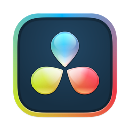
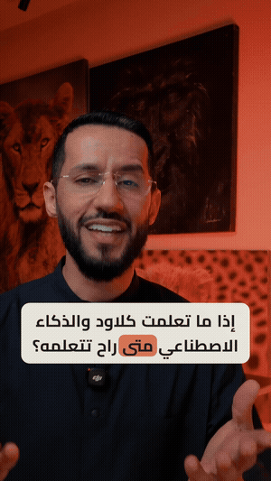

<div dir="rtl">

#  دافنشي — إضافة بلقن الفيديو



عندك **دافنشي ريزولف ستوديو**؟ نفس عقل [بلقن الفيديو](https://github.com/majedphotos/video-ad-editor) ونفس قواعده، والمخرج تايملاين داخل مشروعك:
- **الفيديو** بمسار، **الرسم** بمسار، و**الكابشن** جملة جملة — كل قطعة تقصها وتسحبها لحالها
- **النص يتعدّل** من الإنسبكتر: الكلام، الكلمة المظلّلة، المكان، والألوان
- قل له: **«سوّه بدافنشي»**

<br clear="left">

## التنصيب

يحتاج **بلقن الفيديو** منصّب أول (هو المحرّك: القص، الكابشن، الهوية، حزمة الموشن):

```
/plugin marketplace add majedphotos/majed-plugins
/plugin install majed-video@majed-plugins
/plugin install majed-davinci@majed-plugins
```

وأدوات دافنشي (إم سي بي) مربوطة بـClaude Code.

> ⚠️ **أي نسخة؟** دافنشي ريزولف **ستوديو 21.1+** (المدفوعة) **من موقع بلاك ماجك** — فيها البرمجة اللي يتصل فيها Claude.
>
> ❌ **لا تشتريها من آب ستور الماك:** ما فيها البرمجة أبداً — وترخيصها ما يتحوّل.
>
> ❌ **المجانية** من 21.1 شالوا منها البرمجة.

ماك بس حالياً.

</div>
